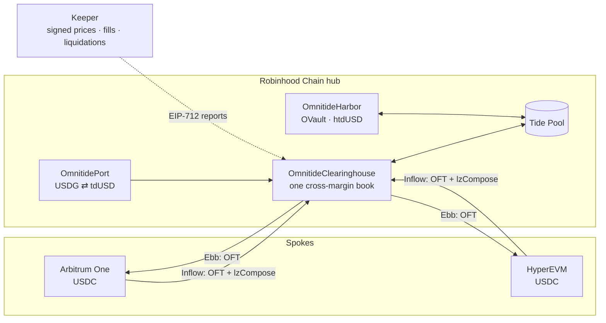

<p align="center">
  
</p>

<h1 align="center">OMNITIDE</h1>

<p align="center">
  <b>Be the tide. Not the target.</b><br/>
  One margin book. Every chain. Beneath the surface.
</p>

<p align="center">
  <a href="https://omnitide.trade">omnitide.trade</a> ·
  <a href="https://testnet.omnitide.trade">testnet</a> ·
  <a href="https://layerzero.network">Powered by LayerZero</a>
</p>

<p align="center">
  
  
  
  
  
</p>

---

Your capital lives on five chains. Your margin lives on one. And every stop you set is a public bounty for whoever reads the mempool first.

OMNITIDE fixes both. Deposit from Arbitrum, HyperEVM or Robinhood Chain and it lands in **one cross-margin account** on the Robinhood Chain hub. Trade BTC next to NVDA next to BABA against that one balance. Pull it back out to whichever chain you want. LayerZero carries the collateral, and the route it takes is published on-chain for anyone to check.

## The tide, in one picture



**Inflow** is one transaction on your home chain: stablecoin in, tdUSD minted 1:1 through the Port, shipped over LayerZero, credited to your margin by `lzCompose` on arrival. **Ebb** runs it backwards to the chain you pick.

## Three releases, one ocean

| Release | Codename | What it unlocks | Status |
|---|---|---|---|
| V1.0 | **Shoreline** | Cross-margin perps on crypto + US stocks, Inflow / Ebb, limit / stop / take-profit, Sea Wall | Mainnet |
| V2.0 | **Current** | Harbor OVault, Tide Chart over lzRead, Tidal Lens stress tests, Book Rank, Riptide alerts, Lifeline | Mainnet |
| V3.0 | **Deep Water** | Deep Mode private positions, Disclosure Key, Sealed Orders, Currents leaderboard, Arena Badges | Testnet |

### V1.0 Shoreline: one book, many doors
- **Cross-margin perps.** Crypto and US equities share one collateral pool, so a winning ETH long backs a fresh TSLA short.
- **Inflow / Ebb.** Collateral moves as an OFT; `lzCompose` credits it the moment it lands.
- **Port.** Native USDG on Robinhood Chain and USDC on Arbitrum and HyperEVM become tdUSD margin 1:1, and redeem back the same way.
- **Sea Wall.** A public page with the live DVN set, block confirmations and caps behind every lane, plus the full LayerZero message trail.
- **Guardrails.** Guardian pause, deposit caps, open-interest caps per market, per-lane rate limits.

### V2.0 Current: read the whole sea
- **Harbor.** An ERC-4626 vault built on LayerZero OVault. Deposit tdUSD from any chain and receive htdUSD shares back on that chain in one round trip. Harbor becomes the Tide Pool, the counterparty to every trade, and earns the 10 bps trading fee plus 80% of every liquidation penalty.
- **Tide Chart.** `OmnitideTideReader` on Arbitrum pulls Harbor state from the hub over **lzRead**. One screen, every chain, no bridge in between.
- **Tidal Lens + RADAR.** Run flash-crash, tech-rotation and black-swan scenarios against your whole book, then get graded A to D by Book Rank.
- **Riptide + Lifeline.** Risk alerts over Telegram, email and push, with a one-tap top-up from another chain before the liquidation line gets close.

### V3.0 Deep Water: beneath the surface
- **Deep Mode.** Sizes and PnL sealed in an encrypted ledger, settled by commitments and keeper attestations.
- **Disclosure Key.** Hand a read-only key to your accountant or auditor, and nobody else.
- **Sealed Orders.** Stops and take-profits stay invisible until they fire. Nothing left to hunt.
- **Currents + Arena.** A verified PnL leaderboard, shareable cards, copy vaults with omnichain deposits, and achievement badges as LayerZero ONFTs.

## Markets

`BTC` `ETH` `SOL` `AVAX` `LINK` `DOGE` · `TSLA` `NVDA` `AAPL` `COIN` `HOOD` `SPY` `AMZN` `MSFT` `GOOGL` `META` `AMD` · `BABA` `PDD` `JD` `BIDU` `NIO` `FXI`

Equity feeds follow the Nasdaq session clock; the China shelf ships its own Hang Seng gap scenario in Tidal Lens.

## LayerZero, end to end

| Primitive | Where OMNITIDE uses it |
|---|---|
| **OFT** | `OmnitideUSD` (tdUSD) moves margin between every chain |
| **lzCompose** | Inflow credits margin on arrival; Harbor deposits and redeems in one hop |
| **OVault** | `OmnitideHarbor` + `OmnitideHarborShareAdapter` + `OmnitideHarborShare` |
| **lzRead** | `OmnitideTideReader` reads hub state from Arbitrum |
| **OApp** | `OmnitideLighthouse` proofs, `OmnitideCouncil` governance messages |
| **ONFT** | `OmnitideBadge` Arena medals |

Every mainnet pathway pins the **LayerZero Labs DVN** with matching confirmations on both ends. The Sea Wall page shows the exact config, read live from the endpoints.

## Mainnet contracts

All contracts are UUPS proxies (addresses never change across upgrades) and are verified on Blockscout and Sourcify.

**Robinhood Chain (4663) · hub**

| Contract | Address |
|---|---|
| OmnitideClearinghouse | [`0xA1f062B1f862c24866eAeed63f7587ab02e8f776`](https://robinhoodchain.blockscout.com/address/0xA1f062B1f862c24866eAeed63f7587ab02e8f776?tab=contract) |
| OmnitideUSD (tdUSD) | [`0xA2A9200c04B036e3003300AdA99D844C97B66075`](https://robinhoodchain.blockscout.com/address/0xA2A9200c04B036e3003300AdA99D844C97B66075?tab=contract) |
| OmnitideOracle | [`0x26BbCba2087e908721376088Df77a77e811203c5`](https://robinhoodchain.blockscout.com/address/0x26BbCba2087e908721376088Df77a77e811203c5?tab=contract) |
| OmnitidePort (USDG) | [`0x0415C654fe747edDeA99B44d6Ce4FD14C281a644`](https://robinhoodchain.blockscout.com/address/0x0415C654fe747edDeA99B44d6Ce4FD14C281a644?tab=contract) |
| OmnitideHarbor (htdUSD) | [`0x3063fe76a842B206c5E7EBb35B786195bF66d064`](https://robinhoodchain.blockscout.com/address/0x3063fe76a842B206c5E7EBb35B786195bF66d064?tab=contract) |
| OmnitideHarborShareAdapter | [`0xC3af9f88aB647223f19082B6bA878Ca70622Cb35`](https://robinhoodchain.blockscout.com/address/0xC3af9f88aB647223f19082B6bA878Ca70622Cb35?tab=contract) |

**Arbitrum One (42161)**

| Contract | Address |
|---|---|
| OmnitideUSD (tdUSD) | [`0x36e7D5b03a86F228601840EE05Cc86eCAE6e6266`](https://arbitrum.blockscout.com/address/0x36e7D5b03a86F228601840EE05Cc86eCAE6e6266?tab=contract) |
| OmnitidePort (USDC) | [`0xaDDA666a53c0190B3FE4fF5818B6eDadeB3Ae946`](https://arbitrum.blockscout.com/address/0xaDDA666a53c0190B3FE4fF5818B6eDadeB3Ae946?tab=contract) |
| OmnitideHarborShare (htdUSD) | [`0x2aB12F893661973Fafc94B5c9df6Ec4336B34b5e`](https://arbitrum.blockscout.com/address/0x2aB12F893661973Fafc94B5c9df6Ec4336B34b5e?tab=contract) |
| OmnitideTideReader | [`0xad5a1449b3d181bA0F8aB7bF03e3CD86B6Fc1A22`](https://arbitrum.blockscout.com/address/0xad5a1449b3d181bA0F8aB7bF03e3CD86B6Fc1A22?tab=contract) |

**HyperEVM (999)**

| Contract | Address |
|---|---|
| OmnitideUSD (tdUSD) | [`0xaDDA666a53c0190B3FE4fF5818B6eDadeB3Ae946`](https://repo.sourcify.dev/999/0xaDDA666a53c0190B3FE4fF5818B6eDadeB3Ae946) |
| OmnitidePort (USDC) | [`0x4aa75054082c4ed4c835cf3aFAA750E03316593E`](https://repo.sourcify.dev/999/0x4aa75054082c4ed4c835cf3aFAA750E03316593E) |

Check every proxy and implementation live from your terminal:

```bash
pnpm mainnet:verification      # all mainnet contracts
pnpm mainnet:v2:verification   # V2 Current only
pnpm testnet:verification      # the full V1–V3 testnet set
```

## Inside the repo

```
apps/
  web/        Next.js 16 terminal + landing, three.js ocean, wagmi/viem, API routes
  keeper/     price feeds, EIP-712 signed reports, order fills, liquidations, Harbor snapshots, lzRead buys, Deep ledger
  indexer/    Ponder over every chain: trades, positions, orders, flows, LayerZero messages
packages/
  contracts/  Solidity (Hardhat 3), deploy / wire / upgrade scripts, chain + market registry
  db/         Prisma 7 schema for candles, prices, snapshots, alerts
```

**Stack:** Solidity 0.8 · LayerZero V2 OApp / OFT / OVault / lzRead · OpenZeppelin UUPS · Hardhat 3 · Next.js 16 · React 19 · wagmi + viem · three.js · Ponder · Prisma 7 + Postgres · Turborepo + pnpm

## Run it

Node 22+, pnpm 10 and a local Postgres.

```bash
pnpm install
pnpm build
pnpm test          # contract, keeper and web suites
```

Copy each `apps/*/.env.example` to `.env`, point `DATABASE_URL` at your Postgres, then:

```bash
pnpm dev           # web on :4391, indexer on :4392, keeper on its .env PORT (4303)
```

`OMNITIDE_ENV=testnet` (default) targets Robinhood Chain Testnet, Arbitrum Sepolia, HyperEVM testnet and Ethereum Sepolia. `OMNITIDE_ENV=mainnet` targets Robinhood Chain, Arbitrum One and HyperEVM. Every chain also has a `<name>Fork` Hardhat network for gas-free dry runs of `scripts/deploy.ts` and `scripts/wire.ts`.

## License

[MIT](LICENSE)
